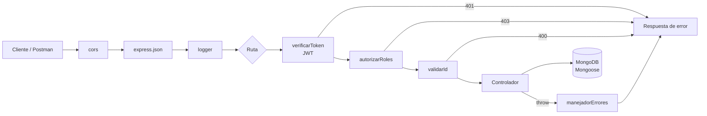
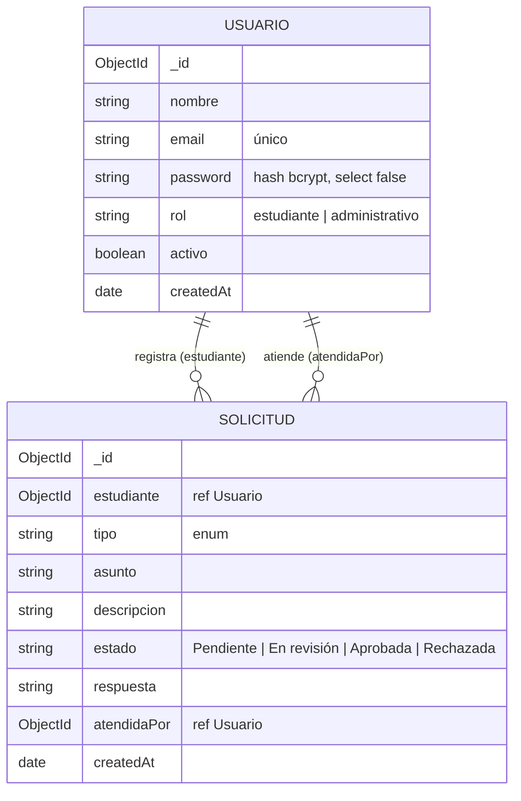

# PA2: Plataforma de Gestión de Solicitudes Académicas (API Backend)


| Dato | Detalle |
|---|---|
| Institución | ISIL |
| Curso | Programación Web II (código 30690) |
| Evaluación | PA2, Proceso de Aprendizaje 2 (sesiones 5 a 7) |
| Periodo | 202620 |
| Tecnologías | Node.js, Express 5, MongoDB, Mongoose, JWT, bcrypt.js, CORS |

**Video público de YouTube:** [PEGAR AQUÍ EL ENLACE]

---

## 1. Integrantes

| N° | Nombre completo | Rol en el equipo | Participación |
|---|---|---|---|
| 1 | Ángel Fernando Reyes Moreno | Backend: autenticación y seguridad | JWT, bcrypt, middleware de roles, CORS |
| 2 | [Nombre completo] | Backend: modelos y persistencia | Conexión MongoDB, esquemas Mongoose, seed |
| 3 | [Nombre completo] | Backend: rutas y controladores CRUD | Endpoints de solicitudes y usuarios |
| 4 | [Nombre completo] | Pruebas y documentación | Pruebas automatizadas, colección Postman, README |
| 5 | [Opcional] | | |

> Ajustar roles y participación según lo que realmente hizo cada integrante.

## 2. Descripción

API REST que gestiona las solicitudes académicas de los estudiantes (constancias, rectificación de notas, retiros de curso, reservas de matrícula, convalidaciones). Los estudiantes registran y siguen sus solicitudes; el área administrativa las revisa, responde y cambia su estado. Es la segunda etapa del caso progresivo del curso: aquí se construye el backend que luego consumirá el frontend.

## 3. Objetivo

Implementar un backend con Node.js y Express que:

1. Exponga servicios REST con operaciones CRUD para la entidad principal (solicitudes).
2. Persista los datos en MongoDB mediante modelos Mongoose.
3. Proteja el acceso con JWT, contraseñas cifradas con bcrypt.js, CORS configurado y autorización basada en roles.

## 4. Desarrollo (procedimiento seguido)

1. **Servidor base (sesión 5).** Se creó el servidor Express con `express.json()`, CORS y un primer CRUD de solicitudes guardado en un arreglo en memoria. Sirvió para validar las rutas con Postman, pero los datos se perdían al reiniciar el servidor.
2. **Persistencia (sesión 6).** Se conectó MongoDB con Mongoose (`src/config/db.js`), se definieron los esquemas `Usuario` y `Solicitud` con validaciones y se reemplazó el arreglo por consultas `find`, `findById`, `create`, `save`, `findByIdAndUpdate` y `deleteOne`. El servidor solo arranca después de conectarse a la base de datos.
3. **Seguridad (sesión 7).** Se agregó registro y login, cifrado de contraseñas con bcrypt en un hook `pre('save')`, emisión y verificación de JWT, un middleware que protege rutas, un middleware de autorización por roles y una lista blanca de orígenes para CORS.
4. **Organización.** El código se separó por capas (`config`, `models`, `controllers`, `routes`, `middlewares`) y `app.js` se separó de `server.js` para poder probar la API sin levantar el puerto.
5. **Pruebas.** Se escribieron pruebas de integración con `node:test` y `supertest` sobre una base de datos de prueba, y se configuró GitHub Actions para ejecutarlas automáticamente con un MongoDB real en cada push.

## 5. Solución propuesta

### 5.1 Arquitectura

```
PA-2-PROGRAMACI-N-WEB-AVANZADA/
├── server.js                  # Arranque: carga .env, conecta MongoDB y levanta Express
├── src/
│   ├── app.js                 # Configuración de Express: CORS, middleware, rutas, errores
│   ├── config/db.js           # Conexión con Mongoose
│   ├── models/
│   │   ├── Usuario.js         # Esquema de usuarios + cifrado bcrypt
│   │   └── Solicitud.js       # Esquema de solicitudes (tipos y estados)
│   ├── controllers/           # Lógica de cada endpoint
│   ├── routes/                # Definición de rutas y middleware por ruta
│   └── middlewares/
│       ├── auth.js            # verificarToken (JWT) y autorizarRoles
│       └── comunes.js         # logger, validarId, 404 y manejador de errores
├── scripts/seed.js            # Crea el administrativo inicial y datos de ejemplo
├── tests/api.test.js          # Pruebas de integración (30 casos)
├── docs/PA2-Solicitudes.postman_collection.json
├── .github/workflows/pruebas.yml
└── .env.example               # Plantilla de variables (sin credenciales reales)
```

Flujo de una petición protegida:



### 5.2 Modelo de datos



Se eligió **referenciar** al usuario (y no incrustarlo) porque un estudiante tiene muchas solicitudes y sus datos pueden cambiar; con `populate()` se obtienen nombre, email y rol al consultar.

### 5.3 Endpoints

| Método | Ruta | Acceso | Descripción |
|---|---|---|---|
| GET | `/` | Público | Estado de la API |
| POST | `/api/auth/registro` | Público | Registra un usuario (siempre con rol estudiante) |
| POST | `/api/auth/login` | Público | Devuelve un JWT |
| GET | `/api/auth/perfil` | Autenticado | Datos del usuario del token |
| GET | `/api/solicitudes` | Autenticado | Estudiante: solo las suyas. Administrativo: todas. Filtros `?estado=` y `?tipo=` |
| GET | `/api/solicitudes/:id` | Dueño o administrativo | Detalle de una solicitud |
| POST | `/api/solicitudes` | Estudiante | Crea una solicitud (estado inicial Pendiente) |
| PUT | `/api/solicitudes/:id` | Estudiante dueño | Edita tipo, asunto o descripción, solo si está Pendiente |
| PATCH | `/api/solicitudes/:id/estado` | Administrativo | Cambia el estado y registra la respuesta |
| DELETE | `/api/solicitudes/:id` | Dueño (si Pendiente) o administrativo | Elimina la solicitud |
| GET | `/api/usuarios` | Administrativo | Lista usuarios (`?rol=`) |
| POST | `/api/usuarios` | Administrativo | Crea usuarios, incluido otro administrativo |
| GET / PUT / DELETE | `/api/usuarios/:id` | Administrativo | Consulta, cambia rol o activo, elimina |

Códigos de respuesta usados: `200`, `201`, `400` (validación o id inválido), `401` (sin token o token inválido), `403` (rol sin permiso u origen CORS no permitido), `404`, `409` (email duplicado o solicitud ya atendida), `500`.

### 5.4 Decisiones técnicas y relación con el sílabo

| Contenido de las sesiones 5 a 7 | Cómo se aplicó | Por qué |
|---|---|---|
| Servidor Express, rutas y solicitudes HTTP | `express.Router()` por recurso, verbos GET/POST/PUT/PATCH/DELETE | Separar recursos facilita mantener y probar cada parte |
| Middleware | `cors`, `express.json`, `logger`, `verificarToken`, `autorizarRoles`, `validarId`, 404 y manejador de errores | Cada middleware tiene una sola responsabilidad y se reutiliza en varias rutas |
| CRUD en el servidor | Controladores de solicitudes y usuarios | Express 5 envía automáticamente los errores de funciones `async` al manejador central, sin `try/catch` repetidos |
| Node.js + MongoDB con Mongoose | `mongoose.connect` con URI desde `.env`; el servidor arranca solo si la conexión funciona | Evita que la API responda sin base de datos |
| Modelado de datos | Esquemas con `required`, `enum`, `minlength`, `match`, `unique`, `timestamps` y referencias `ref` | Las reglas del negocio se validan en un solo lugar y los errores se devuelven como 400 |
| Servicios REST con buenas prácticas | Códigos HTTP correctos, mensajes en JSON, filtros por query, `populate`, sin exponer el hash de la contraseña | Respuestas predecibles para el frontend |
| JWT | `jsonwebtoken` firma `{ id, rol }` con `JWT_SECRET` y expiración configurable | Autenticación sin sesiones en el servidor |
| bcrypt.js | Hash con salt de 10 rondas en `pre('save')`; `password` con `select: false` | Nunca se guarda ni se devuelve la contraseña en texto plano |
| CORS | Lista blanca en `CORS_ORIGIN`; métodos y cabeceras permitidos explícitos | Solo el frontend autorizado puede consumir la API desde el navegador |
| Protección de rutas y roles | `verificarToken` + `autorizarRoles('administrativo')` | El registro público nunca crea administrativos; el estudiante no puede cambiar estados ni ver solicitudes ajenas |

## 6. Cómo ejecutar o revisar

### Requisitos

- Node.js 20 o superior
- MongoDB local (Community Server o Docker) o un cluster gratuito de MongoDB Atlas

### Pasos

```bash
# 1. Clonar e instalar dependencias
git clone https://github.com/75729271-dev/PA-2-PROGRAMACI-N-WEB-AVANZADA.git
cd PA-2-PROGRAMACI-N-WEB-AVANZADA
npm install

# 2. Crear el archivo de variables de entorno
cp .env.example .env
# Editar .env: MONGO_URI, JWT_SECRET y ADMIN_PASSWORD

# 3. (Opcional) MongoDB con Docker
docker run -d --name mongo-pa2 -p 27017:27017 mongo:7

# 4. Crear el usuario administrativo y datos de ejemplo
npm run seed

# 5. Levantar el servidor
npm run dev        # con nodemon
# o
npm start
```

La API queda en `http://localhost:3000`.

### Probar con Postman

1. Importar `docs/PA2-Solicitudes.postman_collection.json`.
2. En las variables de la colección, colocar en `adminPassword` el valor de `ADMIN_PASSWORD` del `.env`.
3. Ejecutar las peticiones en orden. Los tokens y el id de la solicitud se guardan solos en las variables de la colección.

### Ejecutar las pruebas automatizadas

```bash
npm test
```

Usan la base `MONGO_URI_TEST` (por defecto `mongodb://127.0.0.1:27017/solicitudes_academicas_test`), que se borra al empezar y al terminar, así que no afectan los datos de desarrollo. También se ejecutan solas en GitHub Actions en cada push (pestaña **Actions** del repositorio).

## 7. Evidencias

- **Pruebas automatizadas:** `tests/api.test.js` cubre servidor y middleware, registro y login, cifrado bcrypt, rutas protegidas, CRUD completo con verificación directa en MongoDB, restricciones por rol y gestión de usuarios. El resultado de cada ejecución se ve en la pestaña Actions.
- **Colección Postman:** `docs/PA2-Solicitudes.postman_collection.json`.
- **Capturas** (agregar en `docs/evidencias/`):
  - [ ] Consola con `MongoDB conectado` y `Servidor ejecutándose`
  - [ ] Login que devuelve el token
  - [ ] POST, GET, PUT, PATCH y DELETE de solicitudes en Postman
  - [ ] Petición sin token (401) y estudiante intentando cambiar estado (403)
  - [ ] Colecciones `usuarios` y `solicitudes` en MongoDB Compass mostrando las contraseñas cifradas
  - [ ] Datos que siguen ahí después de reiniciar el servidor (persistencia)
  - [ ] Resultado de `npm test`

## 8. Conclusiones

1. Pasar del arreglo en memoria a MongoDB con Mongoose permitió que la información persista entre reinicios y que las reglas del negocio (tipos, estados, campos obligatorios) se validen desde el modelo.
2. Organizar el servidor en rutas, controladores y middleware hizo que cada responsabilidad quede aislada: la seguridad se agrega a una ruta con una sola línea (`verificarToken`, `autorizarRoles`).
3. JWT y bcrypt resuelven dos problemas distintos: bcrypt protege las contraseñas almacenadas y JWT identifica al usuario en cada petición sin guardar sesiones.
4. La autorización por roles no basta con ocultar botones en el frontend: el backend debe impedir que un estudiante cambie estados o vea solicitudes ajenas, y que alguien se registre como administrativo.
5. Las pruebas automatizadas con una base de datos real dan evidencia verificable de que el CRUD, la persistencia y la seguridad funcionan, y detectan errores antes de exponer.

## 9. Seguridad del repositorio

El archivo `.env` está en `.gitignore`. El repositorio solo incluye `.env.example` con valores de ejemplo; no se publican contraseñas, tokens ni cadenas de conexión reales.
